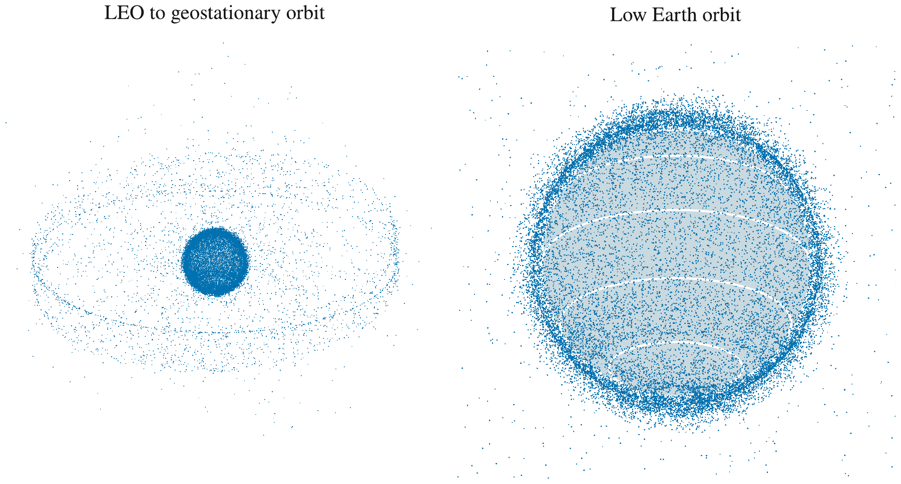

# TROMSØ

**Tromsø Reference Orbital Model for Space Objects**

An open-source model of the orbital debris environment, built in Tromsø, Norway.
Free to use, inspect, modify and contribute to under the [MIT license](LICENSE).
The goal is a community-built alternative to models that require accounts,
restrictive legally dubious license agreements or binary only Windows software. TROMSØ itself requires none of these;
external catalogue providers may have their own access terms. Anyone can freely inspect and critically inspect this model without signing anything. However, it should also be noted that this is work in progress and should only be used for research. The model is not calibrated yet with observations, and is not a realiable tool for space mission safety assessment. 



Catalogue objects propagated to 3 November 2026, 12:00 UTC. Left: Earth through
the geostationary belt. Right: a closer view of low Earth orbit. Object markers
are enlarged; the catalogue includes spacecraft, rocket bodies and debris.
This is a catalogue view, not a prediction of the untracked population.

## Model

Catalogue orbits provide the parent distribution. Fragments receive random
velocity perturbations and empirical area-to-mass ratios, then evolve under
Earth gravity, Sun/Moon gravity and atmospheric drag.

The breakup size law is

$$
N(>L_c) \propto L_c^{-p}, \qquad
\frac{dN}{dL_c} \propto L_c^{-(p+1)},
$$

with $p=1.71$ for collisions and $p=1.6$ for explosions, following the NASA
Standard Breakup Model of [Johnson, Krisko, Liou and Anz-Meador (2001),
*NASA’s new breakup model of EVOLVE 4.0*](https://doi.org/10.1016/S0273-1177(01)00423-9).
Here $L_c$ is
characteristic fragment length, not a radar-equivalent diameter. Drag follows

$$
\mathbf a_D=-\frac{1}{2}C_D\rho\frac{A}{m}
\lVert\mathbf v_{\mathrm{rel}}\rVert\mathbf v_{\mathrm{rel}}.
$$

The present implementation reports **0–2,000 km** altitude and **1–79 mm**
fragments. Trajectories terminate at 120 km; lower reporting cells are masked.
The empirical fragment model allows irregular shapes rather than assuming
all fragments are spheres. Shape matters for both atmospheric drag, through
area-to-mass ratio, and collision probability, through projected area and
orientation. The current model samples empirical area-to-mass ratios;
shape- and orientation-dependent collision cross sections remain future work.

**Status:** an experimental source-and-survival model, not yet a calibrated
global debris environment. The default production rate is one fragment per
day for normalization. GEO is shown above as catalogue context; a synthetic
GEO population is not yet modeled. See the [model notes](docs/model.md) for
assumptions, numerical checks and literature.

## Run

Requires Rust and HDF5 development libraries. Supply a cached GP catalogue
in HDF5 with a `records_json` dataset; catalogue data are not bundled.

```sh
git clone https://github.com/jvierine/tromso.git
cd tromso
cargo test --lib
cargo run --release --bin tromso -- \
  --catalogue /path/to/catalogue.h5 --output output/population.h5 \
  --particles 384 --history-days 30
cargo run --release --bin plot_leo -- output/population.h5
```

Orbit integration uses our [GMAT-compatible Rust DOP853 propagator](https://github.com/jvierine/numerical_propagator),
which supports EGM spherical-harmonic Earth gravity. The current TROMSØ setup
retains central gravity and $J_2$, plus Sun/Moon perturbations. Atmospheric drag
uses NRLMSISE-00 densities through [rmsis](https://github.com/jvierine/rmsis).

Outputs use HDF5; figures use Rustplotlib. Contributions and reproducible
comparisons with observations are welcome.
